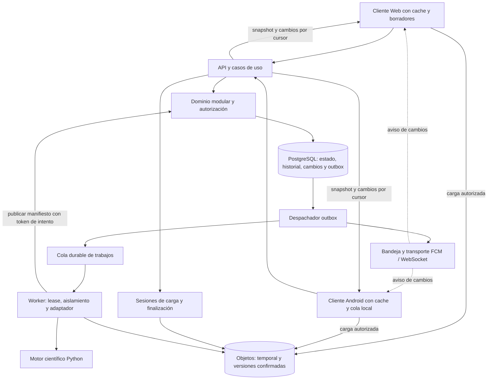

# Auditoría de arquitectura de la plataforma GeoQC

Fecha: 2026-10-14. Documento revisado: [propuesta preliminar archivada](archive/app_propuesta_2026_10_14.md), originalmente `app.md` con 554 líneas en la copia examinada. La [especificación vigente](../app.md) incorpora después el alcance inicial local.
Alcance: arquitectura, lógica de dominio, integración científica, operación, evolución de Web y Android.
Estado: revisión de diseño; las propuestas de este documento requieren incorporarse a la especificación y verificarse mediante implementación. No certifica capacidad, seguridad, algoritmos ni gates científicos.

## 1. Dictamen

El plan contiene una base aprovechable: cálculo fuera del ciclo HTTP, un núcleo científico independiente de las interfaces, archivos originales preservados, revisión auditable y separación conceptual entre calidad y suficiencia. Sin embargo, **todavía no constituye una especificación implementable sin decisiones adicionales**. Varias garantías descritas no se derivan de los mecanismos propuestos y algunos diagramas contradicen el texto.

La conclusión principal es conservar la centralización del estado confirmado en el servidor, separar sus ciclos de vida y reducir las responsabilidades acopladas. La aplicación puede comenzar con un backend modular y procesos de cálculo separados, desplegados de forma independiente. Distribuir desde el inicio todos los módulos en microservicios añadiría coordinación y operación sin una necesidad de carga demostrada.

Se registran **30 hallazgos: 8 críticos, 14 altos y 8 medios**. La severidad expresa el impacto de implementar literalmente el plan; no afirma que ya exista una vulnerabilidad o incidente en un servicio desplegado.

| Severidad | Interpretación | Tratamiento |
| --- | --- | --- |
| Crítica | Puede producir un dictamen inválido, pérdida de una operación, estado incoherente o acceso indebido | Resolver el contrato antes de construir el flujo afectado |
| Alta | Dificulta operación confiable, crecimiento o compatibilidad entre clientes | Resolver antes del piloto integrado |
| Media | Ambigüedad o deuda que encarece evolución, presentación u operación | Planificar y cerrar antes de producción, según alcance |

## 2. Evidencia y límites de la revisión

Se inspeccionaron el plan, configuración de empaquetado, contratos de ingesta y dominio, decisiones diagnósticas, políticas y generadores de dosieres. Se contrastaron los mecanismos externos con documentación primaria. Las referencias a líneas de `app.md` corresponden al documento original y cambiarán al editarlo.

| Evidencia local | Observación relevante |
| --- | --- |
| [`geoqc/core/models.py`](../geoqc/core/models.py) | `Shot` conserva máscaras, motivos, tiempos por canal y hashes; `Geometry` exige CRS, incertidumbre y procedencia |
| [`geoqc/io/readers.py`](../geoqc/io/readers.py) y [`contracts.py`](../geoqc/io/contracts.py) | El lector general despacha SEG-2/SEG-Y y requiere sidecar; conserva muestras no finitas enmascaradas |
| [`geoqc/decision/contracts.py`](../geoqc/decision/contracts.py) | `DecisionAssessment` fija `eligible_for_acceptance=False`; una aceptación humana exige salvedades y queda separada del resultado científico |
| [`docs/requirements_e6.md`](requirements_e6.md) | E6 no habilita aceptación científica de campo; define condiciones de supersesión y acciones |
| [`geoqc/masw/diagnostic_quality.py`](../geoqc/masw/diagnostic_quality.py) | Política DRAFT, cresta aparente y soporte uniforme completo; distingue métricas ausentes de calidad |
| [`geoqc/decision/actions.py`](../geoqc/decision/actions.py) | Las acciones conservan condiciones y supuestos; no existe un espaciado universal recomendado |
| [`tools/report_masw_quality.py`](../tools/report_masw_quality.py) | Carga específica de Oysand, protocolo global y rutas del repositorio; produce digest y registra versiones |
| [`tools/report_trs_dossier.py`](../tools/report_trs_dossier.py) | Geometría predeterminada, lectura directa SEG-2, ventanas por índices y renderizado en el mismo flujo |
| [`pyproject.toml`](../pyproject.toml) | El paquete actual es Python; `matplotlib`, importado por los generadores, no figura en las dependencias declaradas de este archivo |

No se ejecutaron algoritmos, pruebas de carga, dispositivos, parsers contra entradas adversas ni pruebas de infraestructura. Las discrepancias de código indicadas son observaciones estáticas; su alcance numérico requiere una revisión científica específica. No se modificaron algoritmos ni resultados históricos.

## 3. Hallazgos críticos

### C01. La máquina de estados vuelve a acoplar calidad, aprobación y suficiencia

**Ubicación:** `app.md`, líneas 1, 371–384 y 467–473.

El texto separa dos dimensiones, pero el diagrama transforma `APPROVED` en `SUFFICIENCY_VERIFIED` al anexar evidencia externa. Esto elimina la independencia declarada. Un pozo adjunto no acredita por sí mismo pertinencia, cobertura, resolución o cumplimiento del objetivo. Además, los contratos actuales mantienen la elegibilidad científica deshabilitada.

**Corrección:** separar resultado científico, revisión operativa y evaluación de suficiencia por objetivo. Esta última debe identificar versión del objetivo, requisitos, evidencia verificada, responsable, alcance y bloqueos. El dictamen humano no modifica métricas ni habilita automáticamente elegibilidad. Si cambia evidencia usada, la evaluación previa permanece histórica y la vigente se marca para reevaluación.

**Aceptación:** anexar un documento no demuestra suficiencia; aceptar operativamente no cambia `eligible_for_acceptance`; actualizar suficiencia no altera el estado de revisión del dosier.

### C02. El control optimista no define una escritura atómica ni el recurso protegido

**Ubicación:** líneas 28–29, 167–173 y 503–520.

Comprobar una versión y actualizarla en pasos separados permite que dos revisores superen la comprobación. La validación aparece en `NotificationAndSyncHub`, fuera del dueño de la transacción. Tampoco queda claro si el ETag protege adquisición, contenido científico o revisión. El ejemplo usa el ETag del dosier sobre una colección `/reviews` sin definir esa precondición entre recursos.

**Corrección:** asignar un agregado `ReviewCase` con versión propia; ejecutar la comparación y actualización en una operación condicional de PostgreSQL, junto con decisión, directivas, auditoría, registro de cambios y outbox. Preferir `PUT /review-cases/{id}` con `If-Match` obtenido del mismo recurso. Si se mantiene `POST /reviews`, definir explícitamente un `expected_review_version` como precondición de dominio.

**Aceptación:** dos decisiones simultáneas sobre la misma versión producen exactamente una confirmación. El cliente perdedor conserva su borrador y recibe el estado vigente, sin sobreescritura automática. La semántica HTTP se detalla en M02.

### C03. Se supone atomicidad entre PostgreSQL y almacenamiento de objetos

**Ubicación:** líneas 31–32, 482 y 493–495.

El diagrama combina S3 y PostgreSQL en un participante y trata la subida de cuatro artefactos y el cambio de estado como una única confirmación. Puede existir un JSON sin PDF, una fila que referencia un archivo ausente o archivos subidos sin fila confirmada.

**Corrección:** escribir artefactos en claves exclusivas del intento, verificar tamaño y digest y construir un manifiesto. Después, una transacción SQL publica el manifiesto y el resultado, cambia el estado y escribe el outbox. Los lectores solo acceden a manifiestos confirmados. Un reconciliador detecta objetos huérfanos y referencias rotas. Definir si PDF/HTML son obligatorios para revisión o exportaciones derivadas con estado propio.

**Aceptación:** un fallo entre dos subidas no expone un dosier incompleto como listo; un fallo SQL posterior deja objetos recuperables o eliminables con reglas seguras. No se requiere una transacción distribuida para lograr esta publicación controlada.

### C04. El outbox está nombrado pero ausente de las operaciones principales

**Ubicación:** líneas 31–32, 488–495 y 509–510.

Persistir y luego publicar permite perder el trabajo si el proceso cae entre ambos pasos. Ocurre al iniciar cálculo, publicar resultados y emitir dictámenes. El outbox no garantiza recepción del push por el dispositivo ni impide por sí mismo publicaciones repetidas.

**Corrección:** registrar cada cambio y su evento en una transacción SQL. Un despachador con reclamación segura reintenta publicar; los consumidores deduplican por `event_id`. Mantener una bandeja durable de notificaciones y estados separados de envío al proveedor, recepción confirmada y lectura, cuando estas dos últimas existan. La documentación del [patrón outbox](https://docs.aws.amazon.com/prescriptive-guidance/latest/cloud-design-patterns/transactional-outbox.html) contempla explícitamente consumidores idempotentes.

**Aceptación:** una caída inmediatamente después del commit conserva trabajo pendiente; una caída después de publicar y antes de registrar el envío puede duplicar la entrega, pero no sus efectos de negocio.

### C05. Los workers carecen de protocolo frente a duplicados y abandonos

**Ubicación:** líneas 13–14, 459–460 y 549.

El autoescalado no resuelve el worker que muere, pierde el lease o completa un trabajo después de su cancelación. Dos ejecuciones podrían publicar sobre las mismas rutas o reemplazar un resultado vigente. Faltan timeout, heartbeat, clasificación de errores y límites de reintentos.

**Corrección:** separar `ProcessingRun` lógico de `ProcessingAttempt`. Reclamar intentos con lease y un token creciente; verificar ese token al publicar. Una entrega repetida recupera el estado del mismo run. Cada intento usa almacenamiento temporal propio. Diferenciar error transitorio, entrada inválida, formato no soportado, error de cálculo y fallo de exportación; limitar reintentos y conservar errores agotados para inspección.

**Aceptación:** un worker con lease vencido no confirma resultados; un trabajo duplicado no crea dos dosieres oficiales; cancelar y completar en paralelo tiene un único resultado autorizado por el servidor.

### C06. Push y WebSockets se confunden con sincronización durable

**Ubicación:** líneas 1, 28–32 y 474–520.

La actualización instantánea no es una garantía durante desconexiones. FCM no garantiza orden y puede descartar mensajes; Redis Pub/Sub pierde publicaciones para un suscriptor desconectado. El plan no ofrece recuperación histórica. Véanse [FCM: orden y colapso](https://firebase.google.com/docs/cloud-messaging/customize-messages/collapsible-message-types), [FCM: expiración](https://firebase.google.com/docs/cloud-messaging/customize-messages/setting-message-lifespan) y [Redis Pub/Sub](https://redis.io/docs/latest/manual/pubsub/).

**Corrección:** PostgreSQL conserva el estado confirmado y un registro durable de cambios consultable mediante cursor. Push y WebSocket avisan que hay cambios; el cliente consulta el servidor. Los eventos incluyen ID, agregado, versión y versión de esquema. Descartar duplicados y versiones antiguas; ante un salto, releer el recurso. Contemplar snapshot, cursor expirado, bajas y permisos revocados.

**Aceptación:** después de horas sin conexión, ambos clientes convergen sin recibir cada push; un evento v2 posterior a v3 no revierte la pantalla; la recuperación no omite commits tardíos. No usar ingenuamente `MAX(id)` de una secuencia SQL como frontera de commits: el cursor debe tener un protocolo que evite ese salto.

### C07. El modelo de autorización carece de pertenencia y alcance por proyecto

**Ubicación:** líneas 136–154, 183–196 y 551.

Un `User.role` global y un `projectSlug` no expresan que una persona puede revisar un proyecto y operar en otro. No se modelan organización, membresía, revocación ni autorización por objeto. JWT identifica una sesión, pero no sustituye esas reglas.

**Corrección:** introducir organización o cuenta propietaria, proyecto y membresía con roles por ámbito. Autorizar lecturas, escrituras, exportaciones, URLs firmadas, suscripciones y replay de eventos. Resolver el actor desde la sesión; no confiar en `reviewerUserId` enviado por el cliente. Aplicar restricciones referenciales para evitar vínculos entre proyectos. Decidir si el cargador puede revisar su propia adquisición.

**Aceptación:** modificar un UUID, una clave de objeto o un filtro no permite acceder a otro proyecto; revocar una membresía bloquea nuevas operaciones y corta la suscripción correspondiente. Es el riesgo de diseño descrito por [OWASP sobre autorización por objeto](https://api-security.owasp.org/editions/2023/en/0xa1-broken-object-level-authorization/).

### C08. Se asume que los generadores existentes son servicios científicos generales

**Ubicación:** líneas 14, 17–25 y 547–549; scripts actuales.

`report_masw_quality.load_records()` está ligado a Oysand y `PROTOCOL` global. `analyze_trs_survey()` puede asumir 24 canales y dx=5 m, usa el primer dt, infiere estación desde la ruta y reconstruye posiciones. Su SNR usa segmentos `[:140]` y `[150:1500]`, sin demostrar pretrigger; la razón de potencias calculada no resta ruido pese a denominarse neta. Además, `generate_trs_dossier()` escribe JSON sin exigir `allow_nan=False` y en el flujo inspeccionado no construye el digest que anuncia su descripción. Son discrepancias de integración y semántica, no una auditoría numérica completa.

**Corrección:** reutilizar funciones verificadas mediante un adaptador que reciba `Shot`/metadatos explícitos, protocolo y política fijados por ejecución. Extraer cálculo de carga de ejemplos, rutas y renderizado. Alinear SNR, clipping, picks y reciprocidad con los contratos del núcleo antes de publicar esos valores como métricas equivalentes. No completar metadatos científicos con valores predeterminados silenciosos.

**Aceptación:** el mismo registro y protocolo generan el mismo contenido científico por CLI y worker; falta de pretrigger produce abstención explícita; discrepancias de dt o canales se validan; ningún sitio nuevo hereda parámetros de un ejemplo. Este hallazgo bloquea conectar los scripts sin adaptación a una plataforma operativa.

## 4. Hallazgos de severidad alta

### A01. Se mezclan tres tipos diferentes de versión e inmutabilidad

**Ubicación:** líneas 183–196, 283–292 y 533–542.

El dosier supuestamente inmutable contiene un método que lo modifica al revisar. No se distingue repetir una adquisición, corregir sus metadatos y reprocesar exactamente sus datos con otro motor.

**Corrección:** adquisición física identificada de forma estable; revisiones inmutables de metadatos; runs independientes por configuración; dosier científico inmutable; revisión humana mutable solo mediante historial de decisiones inmutables. Una repetición crea otra adquisición; una corrección crea otra revisión; un reprocesamiento crea otro run. Ninguno borra el anterior ni hereda automáticamente aprobación.

**Aceptación:** se reconstruye qué datos, metadatos, ejecución y dictamen vio el revisor, incluso tras corregir geometría o cambiar política.

### A02. El SHA-256 del archivo no cubre la procedencia completa

**Ubicación:** líneas 14, 230–245, 272–278 y 283–292.

La misma señal con otra geometría o referencia temporal puede producir otro resultado. El plan no especifica qué entra en `canonicalDigest`, ni distingue digest científico de hashes de PDF/HTML. Tampoco debe confundirse integridad con autoría o certificación.

**Corrección:** manifiesto versionado con orden e IDs de tiros, hashes de originales y sidecars, geometría, máscaras, protocolo, política, objetivo cuando influya en el cálculo, versión de motor y dependencias. Excluir del digest científico URLs temporales, presencia y decisiones humanas. Dar hash separado a cada artefacto. Definir serialización y verificación del servidor; no exigir a JavaScript reproducir la canonicalización interna de arrays NumPy. SHA-256 no sustituye autenticación ni firma.

**Aceptación:** cambiar un sidecar cambia la identidad de entrada; cambiar una URL firmada no cambia el resultado; cada exportación identifica el resultado científico del que procede.

### A03. La carga directa contradice la secuencia y no tiene cierre seguro

**Ubicación:** líneas 14, 488–490 y 526.

Primero se propone subir directo al almacenamiento y después pasar el archivo por la API. TUS y S3 multipart son alternativas con contratos diferentes. Una URL firmada tampoco vuelve inmutable un objeto: puede reutilizarse y reemplazar una clave existente, según [S3](https://docs.aws.amazon.com/AmazonS3/latest/userguide/using-presigned-url.html).

**Corrección:** elegir un protocolo por alcance inicial. Crear sesión de carga, persistir partes/offset, renovar autorización y finalizar de forma idempotente. Cargar en una zona temporal; verificar el objeto y fijar su versión o promoverlo a una clave final no sobrescribible. El cliente no debe poder volver a escribir el original confirmado. SHA-256 completo, checksum de partes y ETag son campos distintos; el SHA-256 multipart compuesto no equivale al hash ordinario del archivo. Véanse [checksums S3](https://docs.aws.amazon.com/AmazonS3/latest/userguide/checking-object-integrity-upload.html) y [protocolo TUS](https://tus.io/protocols/resumable-upload).

**Aceptación:** un reinicio reanuda el archivo actual y el lote; finalizar dos veces no encola dos runs; cambiar el objeto temporal después de verificarlo no altera la versión usada; una sesión expirada deja limpieza controlada.

### A04. “Conectividad intermitente” solo cubre transporte, no operaciones sin conexión

**Ubicación:** líneas 523–531.

No se modelan borradores, cola local, reinicio del móvil, pérdida de sesión, permisos revocados o decisiones pendientes. Reintentar una decisión obsoleta sin intervención puede confirmar una intención que dejó de ser válida.

**Corrección:** repositorio de datos del cliente con almacenamiento local, versiones observadas y cola persistente de comandos. Cada comando lleva identidad estable, precondición, estado de envío y resultado. Un dictamen sin conexión queda como borrador pendiente; solo el servidor lo confirma. Ante conflicto, exigir nueva revisión humana. La UI distingue datos guardados localmente, pendientes, confirmados y desactualizados. La guía [Android offline-first](https://developer.android.com/topic/architecture/data-layer/offline-first) respalda el uso de fuentes locales y repositorios; las reglas de conflicto propuestas aquí son específicas de GeoQC.

**Aceptación:** cerrar la app no pierde el borrador; recuperar la red no lo presenta como aprobado antes del commit; un `401` no descarta la operación; una membresía revocada detiene su envío.

### A05. Faltan contratos versionados compatibles con aplicaciones móviles antiguas

**Ubicación:** líneas 308–337, 366–369, 409–438 y 528–531.

El plan usa `UTILIZABLE_STAR` donde el núcleo usa `UTILIZABLE`; hay métodos con DTO no definidos y ejemplos con verdict/directiva distintos de sus enumeraciones. No hay contrato de errores, paginación, faltantes ni evolución. Los clientes móviles no se actualizan al mismo ritmo que el servidor.

**Corrección:** contrato OpenAPI fijado a una versión soportada por las herramientas, esquemas científicos propios y ejemplos de ambos métodos. Separar códigos estables de textos traducidos. Publicar SDKs generados como transporte; conservar modelos de presentación independientes. Definir compatibilidad, ventana de soporte, códigos desconocidos y migraciones locales. Un cliente que desconoce un estado puede consultarlo, pero no debe emitir un dictamen que no entiende. La [especificación OpenAPI](https://spec.openapis.org/oas/) define el formato; la política de compatibilidad debe definirla el proyecto.

**Aceptación:** contratos se validan en CI y los clientes anteriores soportados leen nuevas respuestas aditivas; `null` acompañado de motivo no se convierte en cero; no se emiten NaN/Infinity como JSON.

### A06. Geometría, tiempo e identidad de canales están insuficientemente modelados

**Ubicación:** líneas 14, 129, 207–259 y 424–428.

dx/x1/dt no reemplazan coordenadas, CRS, incertidumbre, procedencia ni referencia de disparo. Un canal trigger puede no ser receptor físico. La tolerancia fija de 1e-9 m no coincide literalmente con los controles actuales y no justifica precisión topográfica. La composición de al menos tres canales tampoco representa registros inválidos que deban inspeccionarse.

**Corrección:** conservar identidad de traza, receptor, fuente, componente y rol, con índices claramente declarados. Registrar tiempos por canal y autoridad header/sidecar. Derivar apertura y regularidad sin duplicar campos que puedan divergir; diferenciar apertura geométrica `(N-1)dx` de magnitudes usadas por el kernel, como `N dx`. Versionar las tolerancias científicas en el motor. Un registro se conserva aunque el método no sea aplicable.

**Aceptación:** una coordenada corregida invalida los derivados afectados; una permutación no cambia la identidad de receptores; un canal excluido no hace desaparecer su motivo ni altera silenciosamente el denominador de calidad.

### A07. Las políticas son configurables sin gobierno ni dominio de validez

**Ubicación:** líneas 115, 272–278 y 551.

Un mapa libre de umbrales no codifica unidades, relaciones entre límites ni aplicabilidad. Un administrador podría cambiar una política y reinterpretar resultados históricos o emitir decisiones con criterios DRAFT sin advertencia.

**Corrección:** tipos de política por método, versiones inmutables, hash, estado DRAFT/validado/retirado, evidencia de calibración y alcance. Separar permiso de administrar proyecto de autorizar políticas científicas. Elegir versión explícita para cada run; las actualizaciones requieren reprocesamiento y revisión nuevos. Registrar qué versión estaba permitida en ese proyecto.

**Aceptación:** editar umbrales no cambia un dosier previo; el motor rechaza límites incoherentes; una versión retirada se conserva para reproducir historia pero no inicia trabajos nuevos salvo un modo autorizado de reproducción.

### A08. Las directivas reducen una decisión compleja a una acción y un booleano

**Ubicación:** líneas 391–420 y 508–515.

Una revisión puede requerir varias acciones sobre tiros, canales o bandas. `isResolvedByField` permite cerrar una orden sin acreditar que la nueva adquisición resuelva el problema. Ni una alerta Nyquist ni una correlación baja determinan por sí solas un nuevo dx o más stacks.

**Corrección:** decisión con lista de directivas tipadas, IDs de soporte, responsable, condición, supuestos, unidades y evidencia de cumplimiento. Ciclo `ISSUED → ACKNOWLEDGED → EXECUTED → VERIFIED`, con rechazo/cancelación trazables. Solo verificación autorizada resuelve la directiva. Separar sugerencia del motor de instrucción humana. Una reubicación no se considera automáticamente comparable para supersesión.

**Aceptación:** el operador puede registrar ejecución sin cerrar la verificación; faltan supuestos y la recomendación numérica se abstiene; una directiva parcial no libera todo el tendido.

### A09. La escalabilidad no está vinculada a carga, límites ni prioridades

**Ubicación:** líneas 3–14, 528–531 y 544–551.

No hay tamaños máximos, volumen de tiros, concurrencia por proyecto, memoria por cálculo o presupuesto de exportaciones. Aumentar workers sin límites puede saturar base, red y memoria, y permitir que un proyecto monopolice la cola.

**Corrección:** construir un modelo de carga con tamaños y escenarios de campo. Establecer cuotas, admisión, backpressure, equidad por proyecto, aislamiento CPU/RAM/disco y concurrencia máxima. Validar tamaños y dimensiones declaradas antes de reservar memoria; procesar archivos no confiables en aislamiento, con límites de tiempo y sin acceso innecesario a red o secretos. Escalar según antigüedad de cola y recursos disponibles. Separar cálculo y renderizado si sus medidas lo justifican; limitar hilos de bibliotecas numéricas por proceso. La API no carga matrices científicas completas por petición.

**Aceptación:** bajo carga definida, el tiempo de API permanece dentro de su objetivo y los trabajos grandes no bloquean indefinidamente proyectos pequeños; sobrepasar una cuota produce un estado recuperable y visible.

### A10. Falta arquitectura interna de Web y Android

**Ubicación:** líneas 28–29 y 528–531.

El plan describe infraestructura, pero no evita duplicación de reglas entre interfaces, ni mezcla de gráficos con transporte y sincronización. Compartir backend no resuelve por sí solo mantenibilidad de clientes.

**Corrección:** módulos por capacidad: acceso/proyectos, carga, bandeja, inspección, revisión/directivas y suficiencia. En cada cliente separar transporte, repositorio/cache, casos de uso y presentación. El servidor es autoridad de permisos y transiciones; las interfaces presentan capacidades y validaciones para usabilidad. Compartir contratos, casos de ejemplo y reglas visuales documentadas; no duplicar el motor científico. Elegir tecnología móvil después de probar archivos, almacenamiento persistente, gráficos y segundo plano.

**Aceptación:** cambiar una pantalla no modifica sincronización; sustituir transporte no obliga a reescribir gráficos; ambos clientes muestran los mismos códigos, unidades, motivos y advertencias para un fixture de dosier.

### A11. El empaquetado científico y de renderizado no es reproducible como está propuesto

**Ubicación:** líneas 547–549; `pyproject.toml` y generadores.

Se menciona Python/C++ sin una necesidad demostrada. Los scripts dependen de estructura del repositorio, configuración leída al importar y `matplotlib`, ausente de las dependencias declaradas en `pyproject.toml`. Instalar el paquete base no garantiza poder generar un dosier.

**Corrección:** mantener Python inicialmente; separar dependencias mínimas de cálculo, ingesta opcional y renderizado. Incluir políticas como recursos versionados o entradas explícitas. Crear un entrypoint de ejecución con entradas/salidas tipadas, sin buscar datos en `examples/`. Fijar entorno de workers y registrar digest de imagen, librerías y opciones numéricas. Introducir C++ solo tras perfilar y definir equivalencia.

Los renderizadores deben escapar metadatos de usuario, impedir navegación o descarga arbitraria durante la generación y tratar fórmulas de hojas de cálculo en campos textuales de CSV sin alterar métricas numéricas. Servir HTML exportado desde un origen aislado o con restricciones apropiadas, sin credenciales de la aplicación. Generar claves y rutas en servidor; no convertir nombres de archivo del cliente en rutas locales confiables.

**Aceptación:** una instalación limpia ejecuta un run sin el checkout de ejemplos; ausencia del renderizador no impide un resultado científico válido; CLI y worker registran el mismo manifiesto de entrada.

### A12. No se especifican observabilidad ni diagnóstico de producción

**Ubicación:** omisión transversal.

Con API, cola, workers, objetos y push, un estado “procesando” puede encubrir fallos en cualquiera de ellos. El plan no explica cómo detectar trabajos atascados o una acumulación de outbox.

**Corrección:** correlacionar petición, comando, adquisición, run, intento y evento. Registrar logs estructurados y métricas de edad de cola, duración por fase, memoria, reintentos, errores de parser, lag de outbox, conflictos y recuperación de clientes. Definir alertas y procedimientos. Separar bitácora auditable de logs de diagnóstico; redactar tokens, URLs firmadas y datos innecesarios.

**Aceptación:** desde un run fallido se identifica su intento, entrada y fase sin revisar manualmente toda la infraestructura; una caída del despachador genera alerta antes de que el usuario tenga que reportarla.

### A13. No hay recuperación coordinada ni evolución de base y servicios

**Ubicación:** omisión transversal.

Respaldar PostgreSQL sin los objetos referenciados no recupera dosieres. Desplegar un esquema incompatible puede romper móviles antiguos y workers con trabajos pendientes.

**Corrección:** definir RPO/RTO propuestos y luego ensayados, backups de base/objetos, reconciliación y restauración integral. Migraciones expansivas antes de retirar campos, compatibilidad de mensajes pendientes y rollback de aplicación compatible con esquema. Separar desarrollo/pruebas/producción y manejar secretos fuera del repositorio. Versionar runbooks y registrar versiones desplegadas.

**Aceptación:** restauración de una muestra recupera originales, manifiestos, decisiones y permisos coherentes; un despliegue no invalida trabajos aceptados ni contratos de clientes soportados.

### A14. No se define concurrencia fuera del dictamen ni revisión posterior

**Ubicación:** líneas 183–196, 283–292, 409–420 y 449–473.

No hay reglas para corregir metadatos durante cálculo, cambiar objetivo durante evaluación, retirar un dictamen o aprobar una adquisición cuando otro run ya es vigente. El rechazo regresa el mismo objeto a `UPLOADING` aunque el texto exige crear un hijo. La presencia `IN_INSPECTION` tampoco debe cambiar el estado auditable global.

**Corrección:** versiones por agregado y referencias cruzadas explícitas. Al confirmar revisión, comprobar también que el resultado/revisión de entrada sigue vigente o permitir una revisión histórica explícita con alcance restringido. Una revisión confirmada se sustituye mediante reapertura autorizada y otra decisión. Cambios de objetivo marcan evaluaciones dependientes para revisión; presencia se mantiene efímera. Repetir crea un hijo y conserva el padre.

**Aceptación:** no se libera un tendido nuevo mediante la aprobación de un resultado obsoleto; reapertura conserva decisiones anteriores; abrir una pantalla no incrementa versiones científicas ni bloquea otro revisor.

## 5. Hallazgos de severidad media

### M01. `Int8` es ambiguo y su transporte puede perder precisión

**Ubicación:** líneas 159–173, 191 y 288–291.

Puede significar entero de 8 bits para un cliente y alias de entero de 8 bytes en SQL. [PostgreSQL documenta](https://www.postgresql.org/docs/current/datatype-numeric.html) `bigint` como entero de 8 bytes. Definir tipos por contrato: versión positiva, `BIGINT` en base y cadena decimal o un rango seguro explícito en JSON para JavaScript. UUIDs y ETags permanecen opacos. Verificar ida y vuelta de valores límite sin truncamiento.

### M02. `If-Match` obsoleto se responde con el código equivocado

**Ubicación:** líneas 29 y 518–520.

Una precondición HTTP `If-Match` que falla corresponde a `412 Precondition Failed`, conforme a [RFC 9110, sección 13.1.1](https://www.rfc-editor.org/rfc/rfc9110.html#section-13.1.1). Reservar `409` para conflictos de negocio o la precondición explícita de dominio; `428` puede exigir una precondición ausente, según [RFC 6585](https://www.rfc-editor.org/rfc/rfc6585.html#section-3). Definir ETag fuerte del recurso protegido, diferente del ETag S3 y del digest científico, y un cuerpo de error estable con la versión vigente autorizada.

### M03. “Multiplataforma” y capacidades por rol no tienen alcance cerrado

**Ubicación:** líneas 40–49, 454 y 488.

Los diagramas atan campo a Web y gabinete a Android/Web, aunque el texto sugiere otras combinaciones. No se define si se requiere iOS, escritorio instalable o cálculo local sin red. Especificar matriz de capacidades por rol y plataforma. La autorización depende del usuario y del proyecto, no del sistema operativo. Considerar el cálculo local como capacidad separada: portar la UI no porta automáticamente NumPy/SciPy al móvil.

### M04. Los diagramas y fórmulas todavía no funcionan como especificación

**Ubicación:** todo `app.md`; sección 6 vacía.

Faltan fences Mermaid, las fórmulas están partidas, se anuncian cuatro paquetes y se dibujan cinco. El supuesto diagrama UML de casos de uso es un flowchart Mermaid con relaciones informales. El dominio omite clases referidas y alterna nombres como `QCDossier`/`QCDossier20`. Reparar formato, añadir glosario y diccionario de estados, y elegir una notación coherente. El explorador interactivo puede quedar fuera del MVP; no sustituye contratos ni criterios verificables.

### M05. Las alternativas tecnológicas abiertas y los patrones multiplican decisiones

**Ubicación:** líneas 13–25 y 544–551.

Redis Streams/RabbitMQ, Celery/FastStream y Strategy/Template Method no son opciones equivalentes ni garantías de mantenibilidad. Escribir ADR por decisión, con contexto, opciones, coste operativo y condiciones de revisión. Para el inicio, un backend modular, un motor Python y procesos worker separados permiten escalar cálculo sin distribuir el dominio completo. Introducir interfaces en límites reales y preferir composición sobre jerarquías que fuerzan MASW y TRS a fingir resultados idénticos.

### M06. MinIO/S3 y distintos brokers se presentan como intercambiables

**Ubicación:** líneas 14, 482 y 549.

La compatibilidad nominal no demuestra igualdad en checksum, carga multipart, versionado, permisos o recuperación. Definir puertos pequeños y pruebas de conformidad para la combinación seleccionada. Separar broker durable de la difusión efímera de sockets. No abstraer todas las funciones de todos los proveedores. Los mensajes de trabajo contienen referencias pequeñas y verificadas; no matrices ni URLs que expiren antes de consumirlos.

### M07. Los 15 KB y 200 ms son afirmaciones sin medición ni límites

**Ubicación:** líneas 528–531.

El tamaño depende de tiros, trazas, bins y comparaciones; compresión no limita memoria ni coste gráfico. Definir resumen paginado y detalle por tiro/traza/banda. Reducir puntos exclusivamente para visualización con indicación explícita; el dictamen conserva referencias a resolución original. Medir p50/p95 en dispositivo y red representativos, distinguiendo lectura local, red, descompresión y renderizado. Brotli queda como optimización compatible, no como condición científica.

### M08. Inmutabilidad no define retención ni limpieza segura

**Ubicación:** líneas 14 y 533–542.

Sin políticas, intentos fallidos, multipart incompletos, figuras, eventos y cachés crecen indefinidamente. Clasificar originales, resultados oficiales, temporales, auditoría y exportaciones regenerables. Definir retención por proyecto, referencias protegidas, archivo y borrado autorizado. Limpiar por inventario y antigüedad con margen para runs activos; registrar la acción. La cache local muestra límites y permite descargar dosieres concretos; los permisos revocados se aplican al volver a conectar y se declara el límite de revocación sobre copias ya descargadas.

## 6. Arquitectura propuesta para consolidar el plan

Esta es una propuesta de diseño, no una elección de proveedores o frameworks ya aprobada. Mantiene un solo dueño de las transacciones de dominio. Los workers calculan y presentan resultados por un puerto autorizado; no editan arbitrariamente tablas de revisión ni credenciales de usuarios.

La implementación inicial puede usar un monorepo: núcleo `geoqc/`, adaptadores de procesamiento, backend con módulos internos, contratos y clientes. La ubicación exacta se decide al crear el esqueleto; no exige mover ahora el paquete científico ni regenerar evidencia. La extracción de servicios se justifica por necesidad de escalado independiente, propiedad de equipo, seguridad o frecuencia de despliegue medidas.

### 6.1 Agregados y entidades mínimos

| Entidad | Responsabilidad y regla |
| --- | --- |
| `Organization`, `Project`, `ProjectMembership` | Propiedad, aislamiento y permisos por ámbito |
| `EngineeringTargetRevision` | Objetivo y requisitos inmutables, con unidades y alcance |
| `Acquisition`, `AcquisitionRevision` | Evento físico y versiones de metadatos; vínculo explícito de repetición |
| `ShotRecord`, `RawArtifact` | Original, fuente/receptores, rol de canales y versión concreta del objeto |
| `UploadSession` | Transferencia, partes/offset, verificación y expiración |
| `PolicyVersion`, `ProtocolVersion` | Configuración tipada e inmutable con procedencia y aplicabilidad |
| `ProcessingRun`, `ProcessingAttempt` | Cálculo lógico, entrega/reintento, lease y entorno |
| `ScientificDossier`, `ArtifactManifest` | Resultado inmutable y artefactos verificados publicados |
| `ReviewCase`, `ReviewDecision` | Estado vigente con OCC e historial ligado al digest y alcance revisados |
| `FieldDirective`, `DirectiveEvidence` | Acciones múltiples y verificación de cumplimiento |
| `SufficiencyEvaluation` | Evaluación por versión de objetivo y conjunto explícito de evidencia |
| `OutboxEvent`, `ChangeEntry`, `Notification` | Publicación, recuperación durable y bandeja del usuario |
| `DeviceRegistration` | Token, usuario, dispositivo, plataforma y estado de vigencia |

No almacenar cada muestra o bin como fila transaccional por defecto. Conservar resultados extensos como artefactos versionados; indexar en SQL identidades, estados y los resúmenes necesarios para consultas. Si luego se necesita búsqueda analítica por bin, añadir una proyección derivada medible y regenerable.

### 6.2 Invariantes que deben quedar en servidor y base

1. Un resultado publicado referencia una revisión de adquisición y un manifiesto inmutables.
2. Toda referencia de dominio pertenece al mismo ámbito autorizado o pasa por una operación explícita de compartición.
3. Un dictamen identifica exactamente resultado, digest, alcance y actor; no modifica el contenido científico.
4. Una directiva ejecutada no equivale a una directiva verificada.
5. Un adjunto no cambia por sí solo la suficiencia a demostrada.
6. Solo el intento que conserva el token vigente puede publicar un run.
7. Un cambio confirmado y su evento durable se escriben en la misma transacción.
8. Una corrección, repetición o ejecución nueva conserva la evidencia histórica y exige revisar vigencia.
9. Falta de dato, no aplicabilidad, invalidez y calidad mala son estados distintos en API y UI.
10. IDs, fechas de servidor y permisos no se aceptan como autoridad desde datos enviados por el cliente.

### 6.3 Ciclos separados

| Ciclo | Estados orientativos | Regla de separación |
| --- | --- | --- |
| Carga | `CREATED`, `UPLOADING`, `VERIFYING`, `VERIFIED`, `REJECTED`, `EXPIRED`, `CANCELLED` | Verificar bytes no verifica suficiencia científica |
| Run | `QUEUED`, `RUNNING`, `RETRY_WAIT`, `SUCCEEDED`, `FAILED`, `CANCELLED` | Un run nuevo puede reutilizar originales; un retry crea otro intento |
| Exportación | `PENDING`, `RUNNING`, `READY`, `FAILED` | Fallar PDF no invalida automáticamente el JSON científico |
| Revisión | `PENDING`, `APPROVED_OPERATIONALLY`, `APPROVED_WITH_OBSERVATIONS`, `ACTION_REQUIRED`, `REOPENED`, `WITHDRAWN` | Decisión humana con alcance; no certificación científica automática |
| Directiva | `ISSUED`, `ACKNOWLEDGED`, `EXECUTED`, `VERIFIED`, `CANCELLED` | El servidor valida transiciones y evidencia |
| Suficiencia | `NOT_DEMONSTRATED`, `UNDER_REVIEW`, `DEMONSTRATED`, `INSUFFICIENT`, `REEVALUATION_REQUIRED` | Siempre asociada a objetivo, soporte y evidencia concretos |

Estos nombres son propuestas; deben mapearse al vocabulario científico actual sin renombrar contratos históricos silenciosamente. Para cada transición se necesita actor permitido, precondiciones, efecto transaccional, evento y tratamiento de repetición. La finitud de muestras se valida en un proceso de ingesta aislado después de cargar; una máscara aceptable puede permitir diagnóstico parcial. El endpoint de carga no debe hacer el cálculo completo para decidir si puede encolarlo.

### 6.4 Operaciones API orientativas

| Operación | Propósito y contrato |
| --- | --- |
| `POST /v1/acquisitions` | Crear identidad y borrador; clave de idempotencia |
| `POST /v1/acquisitions/{id}/revisions` | Congelar metadatos validados sin sobrescribir historia |
| `POST /v1/upload-sessions` | Autorizar transferencia temporal con límites de tamaño y ámbito |
| `POST /v1/upload-sessions/{id}/complete` | Cerrar transferencia idempotentemente; verificación puede ser asíncrona |
| `POST /v1/processing-runs` | Fijar revisión, archivos, método, protocolo y política; `202` y recurso de seguimiento |
| `GET /v1/processing-runs/{id}` | Estado, progreso por fase y error recuperable; sin inventar porcentaje exacto |
| `GET /v1/dossiers/{id}` | Cabecera científica, procedencia y enlaces de detalle autorizados |
| `GET /v1/dossiers/{id}/shots` | Datos paginados; detalle y resolución visual explícitos |
| `GET /v1/review-cases/{id}` | Estado revisable y ETag fuerte de esta representación |
| `PUT /v1/review-cases/{id}` | Comando de decisión con `If-Match` y clave de idempotencia |
| `POST /v1/review-cases/{id}/reopenings` | Reapertura autorizada y auditada con precondición de dominio |
| `POST /v1/directives/{id}/evidence` | Registrar cumplimiento sin verificar automáticamente |
| `POST /v1/sufficiency-evaluations` | Solicitar evaluación explícita del objetivo y evidencias |
| `GET /v1/projects/{id}/changes?cursor=...` | Recuperación durable, paginación, cursor y bajas |
| `POST /v1/artifacts/{id}/download-grants` | Obtener acceso temporal después de autorizar cada solicitud |

Definir error estructurado con `code`, `message`, `request_id`, detalles seguros y, cuando corresponda, recurso/versión actual. No devolver trazas internas ni rutas del servidor. Las transiciones y capacidades se documentan en el contrato para impedir que cada cliente invente reglas distintas.

La clave de idempotencia se acota a actor, proyecto y operación; se asocia al hash del comando normalizado. Misma clave y mismo contenido devuelven el resultado ya confirmado; contenido distinto produce conflicto. La reserva de clave y su resultado se coordinan con la transacción del comando. Para operaciones aún en curso se devuelve el recurso de seguimiento. Una reproducción de respuesta debe seguir autorizada en el momento del reintento. Definir retención de claves acorde con la ventana de trabajo sin red.

### 6.5 Transacción de revisión y protocolo de publicación

Para una revisión, dentro de una transacción:

1. Validar sesión, membresía, alcance, vigencia del resultado y permiso para decidir.
2. Resolver una repetición idempotente ya confirmada antes de rechazarla por una versión que esa misma operación incrementó.
3. Actualizar `ReviewCase` con condición por ID, ámbito, versión y estado permitido; cero filas significa conflicto o incumplimiento de precondición, tras comprobar visibilidad.
4. Insertar decisión inmutable, directivas y auditoría.
5. Insertar cambio durable y evento outbox con versiones del agregado.
6. Guardar resultado del comando y confirmar. Después responder; la entrega de push no bloquea esta confirmación.

Para un resultado científico:

1. Reclamar run e intento con token; descargar las versiones de objeto fijadas y verificar hashes.
2. Validar contratos y ejecutar cálculo aislado con límites y cancelación controlada.
3. Escribir artefactos y manifiesto en claves exclusivas; verificar disponibilidad e integridad.
4. Pedir publicación al caso de uso que comprueba token, estado y manifiesto y confirma resultado/outbox en SQL.
5. Confirmar consumo de cola después de persistir el desenlace. Si la confirmación al broker se pierde, recuperar el desenlace existente al reentregar.

No prometer ejecución exactamente una vez de extremo a extremo. Diseñar entregas repetibles con efectos de negocio únicos y verificados por restricciones, transacciones e identidad de comandos.

## 7. Mantenibilidad de los clientes

Web y Android deben compartir significado y contratos, aunque sus implementaciones de almacenamiento, archivos y ciclo de vida sean diferentes. Una biblioteca de componentes compartida no debe ser requisito para comenzar; sí lo son fixtures de dosier y expectativas idénticas de estado.

| Capacidad | Regla común | Particularidad a verificar |
| --- | --- | --- |
| Sesión | Renovación, revocación y pertenencia por proyecto | Almacenamiento de credenciales apropiado a navegador o dispositivo |
| Carga | Sesión persistente, identidad de archivo y progreso recuperable | Permisos de archivo, cierre de pestaña, reinicio de proceso y límites de segundo plano |
| Consulta | Cache con revisión/digest, hora de sincronización y faltantes | Límites locales de espacio y estrategia de descarga |
| Dictamen | Borrador, precondición y confirmación del servidor | Recuperación tras cerrar pantalla y conflictos sin perder la justificación |
| Gráficos | Unidades, soporte original, estados desconocidos y advertencias | Zoom, densidad de datos, tamaño de pantalla y accesibilidad sin depender solo del color |
| Avisos | Invalidan cache y llevan al recurso autorizado | Push deshabilitado, app suspendida o socket desconectado |
| Actualización | Compatibilidad y migraciones de cache | Servidor nuevo frente a app instalada antigua; pestaña abierta con versión anterior |

Construir una prueba técnica acotada del cliente móvil para cargas grandes, pausa/reanudación, cache y gráficos antes de decidir entre solución nativa y un framework compartido. No hay evidencia suficiente en el repositorio para elegir hoy ese framework con rigor. Definir explícitamente si Android debe calcular sin conexión; esa capacidad cambia sustancialmente la integración, validación y distribución del motor.

## 8. Verificaciones necesarias antes del piloto

Estas son pruebas propuestas para la futura plataforma; no se ejecutaron durante esta auditoría.

| ID | Escenario | Resultado exigido |
| --- | --- | --- |
| V-APP-01 | Dos revisores confirman sobre la misma versión | Una decisión confirmada; otra conserva borrador y recibe conflicto |
| V-APP-02 | El cliente pierde la respuesta después del commit y reintenta | Devuelve la decisión original sin duplicar directivas |
| V-APP-03 | Misma clave idempotente con otro contenido | Rechazo explícito, ningún efecto adicional |
| V-APP-04 | Caída tras commit y antes de publicar outbox | El evento se publica al recuperar el servicio |
| V-APP-05 | Caída después de publicar y antes de marcar enviado | Reentrega sin duplicar efecto de negocio |
| V-APP-06 | Worker muere o se vence su lease durante cálculo | Recuperación con otro intento; intento antiguo no publica |
| V-APP-07 | Cancelación concurrente con publicación | Un desenlace válido, artefactos parciales no visibles |
| V-APP-08 | Fallo tras subir solo parte de artefactos | No se declara listo un manifiesto incompleto |
| V-APP-09 | Evento v3 llega antes de v2 y luego se duplica | La UI conserva v3 y converge con el servidor |
| V-APP-10 | Cliente desconectado, cursor expirado o commit tardío | Snapshot/replay recupera todos los cambios autorizados |
| V-APP-11 | Cambio de UUID, proyecto, objeto o canal de eventos | No expone contenido de otro ámbito |
| V-APP-12 | Membresía revocada mientras hay socket y comandos pendientes | Se detienen nuevos accesos/envíos y se actualiza la sesión |
| V-APP-13 | Carga interrumpida con URL vencida y proceso reiniciado | Continúa con autorización nueva y original correcto |
| V-APP-14 | Reutilización de URL temporal después de finalizar | No altera los bytes/versiones usados por el run |
| V-APP-15 | Muestras no finitas, canales irregulares o dt heterogéneo | Conserva evidencia; valida o se abstiene según método, sin datos inventados |
| V-APP-16 | Mismo caso por CLI y worker | Mismo contenido científico bajo entorno/control numérico definidos |
| V-APP-17 | Cambiar política, metadatos, objetivo o motor | Nuevo linaje y reevaluación de vigencia; historia preservada |
| V-APP-18 | PDF falla pero cálculo termina | Estado de exportación coherente con política de revisión definida |
| V-APP-19 | Cliente anterior recibe campo o enum nuevo | Consulta segura; no dictamina sobre estados desconocidos |
| V-APP-20 | Restore y despliegue con jobs pendientes | Referencias recuperadas y contratos compatibles |
| V-APP-21 | Carga concurrente de proyectos grandes y pequeños | Cumple equidad, cuotas y objetivos de latencia medidos |
| V-APP-22 | Adjuntar evidencia, aceptar operativamente o ejecutar directiva | Ninguna operación demuestra suficiencia automáticamente |

Los casos científicos se apoyan en los protocolos y validaciones existentes: no sustituyen G5 ampliado, G6 ni calibración de campo. El acuerdo numérico entre entornos debe definir tolerancias justificadas por operación y distinguir igualdad de contenido de igualdad binaria de un PDF.

## 9. Secuencia de implementación con criterios de salida

| Etapa | Entregable | Criterio de salida |
| --- | --- | --- |
| 0. Consolidar especificación | Glosario, agregados, invariantes, permisos, estados, matriz de formatos, contratos y ADR | C01–C08 resueltos en diseño, sin contradicciones entre texto y diagramas |
| 1. Adaptar motor | API científica tipada y renderizadores separados; fixtures reproducibles | CLI/worker equivalentes; sin metadatos silenciosos ni dependencia de Oysand para casos generales |
| 2. Flujo central mínimo | Proyecto, carga, ingesta, run, manifiesto, dosier y revisión; outbox/OCC/idempotencia | Pasa concurrencia, recuperación de trabajos y autorización por objeto |
| 3. Clientes y recuperación | Web y Android para consulta/revisión; cache, borradores, cursor y avisos | Convergen tras desconexión y sobreviven reinicio sin perder intención ni confirmar localmente |
| 4. Operación de campo | Directivas múltiples, nuevas adquisiciones, evidencia de ejecución y verificación | Historia completa y resolución por evidencia; original preservado |
| 5. Piloto controlado | Observabilidad, límites, carga, restore, migraciones y pruebas de compatibilidad | Objetivos medidos con dispositivos/datos representativos y procedimientos ensayados |
| 6. Suficiencia y crecimiento | Evaluación por objetivo; extracción de servicios si las medidas la justifican | Evidencia científica aplicable; escalado basado en cuellos de botella observados |

El primer flujo vertical debe incluir autorización, integridad, errores, idempotencia y revisión concurrente desde su diseño. Push avanzado, explorador interactivo, múltiples proveedores, C++ y autoescalado sofisticado pueden incorporarse después de validar ese recorrido.

## 10. Decisiones pendientes explícitas

1. Plataformas obligatorias y roles disponibles en cada una; necesidad de cálculo local sin internet.
2. Tamaños máximos por archivo/lote, volumen de proyectos, usuarios y horizonte de crecimiento.
3. Formatos del primer release: el lector general observado soporta SEG-2/SEG-Y; SU no está habilitado en ese recorrido y ASCII solo tiene adaptadores específicos examinados. Cada formato requiere contrato, metadatos y pruebas propios.
4. Condición de revisión: resultado científico listo frente a paquete completo de exportaciones.
5. Autoridad para aprobar operativamente, reabrir, verificar directivas y evaluar suficiencia; tratamiento de salvedades DRAFT.
6. Proveedor inicial de objetos, protocolo de carga y combinación compatible de broker/consumidor.
7. Objetivos de disponibilidad, latencia y recuperación, después de establecer carga y presupuesto.
8. Retención de originales, resultados, cambios, comandos y datos descargados.

Estas decisiones deben registrarse con responsable y fecha objetivo. Las decisiones reversibles de implementación no requieren bloquear todo el proyecto; las que cambian autoridad científica, contratos o recuperación sí deben resolverse antes del flujo correspondiente.

## 11. Cambios documentales sugeridos para `app.md`

Conservar su intención funcional y reorganizarlo como especificación versionada: alcance y exclusiones; glosario; invariantes; modelo de dominio; transiciones con permisos; contratos API/eventos; carga y publicación; operación sin red; seguridad por proyecto; requisitos de capacidad/recuperación; arquitectura de clientes; etapas y verificación.

Sustituir afirmaciones absolutas de consistencia instantánea o push infalible por garantías precisas: decisiones atómicas en servidor, artefactos publicados tras verificación y convergencia de clientes al recuperar comunicación. Reparar los diagramas con estas reglas antes de elegir infraestructura. La auditoría inicial conservó `app.md` intacto; al consolidar después APP-LOCAL-0.1 se archivó esa propuesta sin cambios para mantener la comparación y las referencias de líneas de este informe.
