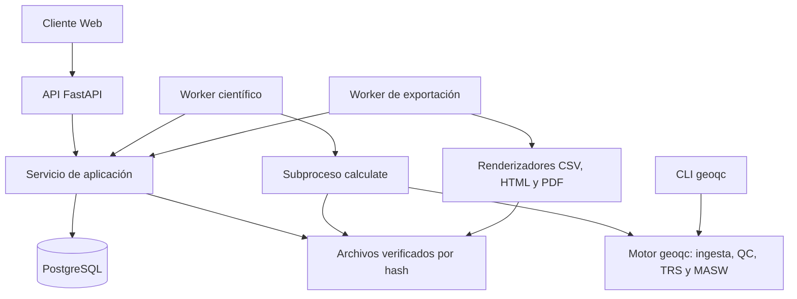

# Manual de arquitectura, mantenimiento y evolución de GeoQC

Fecha de revisión: 2026-10-21. Base de código consultada: `ffeb193`.

Esta guía conecta el propósito del sistema con su implementación. Está dirigida a
quien necesita entenderlo, cambiar una regla, corregir un fallo o preparar una
ampliación. Los ejemplos de comandos usan PowerShell desde la raíz del repositorio.
Las rutas de código se enlazan sin números de línea para facilitar su mantenimiento.

## Índice y orden de lectura

1. [Qué hace el sistema y qué significa cada cosa](#1-qué-hace-el-sistema).
2. [Arquitectura y mapa del código](#2-arquitectura-y-mapa-del-código).
3. [Recorrido completo de un registro](#3-recorrido-completo-de-un-registro).
4. [Procesamiento científico y criterios](#4-procesamiento-científico-y-criterios).
5. [Instalación y operación local](#5-instalación-y-operación-local).
6. [Dónde y cómo modificarlo](#6-dónde-y-cómo-modificarlo).
7. [Pruebas y comprobaciones](#7-pruebas-y-comprobaciones).
8. [Diagnóstico y recuperación](#8-diagnóstico-y-recuperación).
9. [Cómo ampliarlo y escalarlo](#9-cómo-ampliarlo-y-escalarlo).
10. [Documentación relacionada y mantenimiento de esta guía](#10-documentación-relacionada).

Para aprender la metodología geofísica, complementar esta guía con el
[manual técnico LaTeX](manual_qc_geofisico.tex). Para reproducir el caso actual,
seguir el [ejemplo KM](../examples/km_app/README.md).

## 1. Qué hace el sistema

GeoQC recibe registros sísmicos y metadatos, comprueba su integridad, ejecuta
diagnósticos de calidad y genera un dosier reproducible. La aplicación local
permite cargar esos registros, ejecutar el cálculo, consultar resultados,
exportarlos y registrar una revisión humana.

| Término | Significado práctico |
| --- | --- |
| MASW | Análisis de ondas superficiales; el recorrido local estudia dispersión aparente y su usabilidad diagnóstica. |
| TRS | Refracción sísmica; el recorrido local estudia calidad del registro y primeros arribos de onda P. |
| Traza | Serie de muestras de un canal. Un registro contiene varias trazas. |
| Sidecar | JSON que acompaña al archivo sísmico y declara adquisición y geometría. No es una lista informal de suposiciones. |
| Protocolo | Parámetros explícitos del procesamiento: ventanas, rejillas, criterios y condiciones del análisis. |
| Política | Reglas para interpretar métricas y asignar categorías; debe quedar identificada en el resultado. |
| `Shot` | Objeto científico validado con muestras, máscara de validez, tiempos, geometría y adquisición. |
| Adquisición | Identidad estable del experimento dentro de un proyecto. |
| Revisión de adquisición | Selección inmutable de los registros que se van a procesar. |
| Run | Solicitud de procesamiento con entradas, protocolo y versión del motor fijados. |
| Intento | Ejecución concreta de un run. Puede fallar o perder su permiso de publicación. |
| Worker | Proceso que toma trabajos pendientes y supervisa el cálculo. |
| Dosier | Resultado científico publicado, con métricas, motivos, limitaciones y procedencia. |
| Digest / hash | Huella del contenido para comprobar integridad e identificar exactamente qué se procesó. |
| Lease / heartbeat | Permiso temporal de un intento y su renovación periódica. Evitan que un intento abandonado publique después. |
| Idempotencia | Repetir el mismo comando lógico con la misma clave conserva su efecto confirmado. |
| ETag | Versión de una representación HTTP; permite detectar cambios y conflictos. |

### Reglas que una modificación debe conservar

- Calidad diagnóstica, revisión humana y suficiencia para un objetivo ingenieril
  son resultados diferentes. Una aceptación humana no demuestra suficiencia.
- Un dato desconocido conserva su estado y motivo; no se sustituye por cero.
- Los originales y los resultados publicados se conservan. Corregir metadatos
  exige otra revisión; recalcular exige otro run.
- Cada resultado conserva protocolo, política y procedencia. Cambiar una regla
  no cambia retrospectivamente los dosieres existentes.
- La autorización se comprueba en el servidor por usuario y proyecto.

El alcance local conserva `eligible_for_acceptance=false` y suficiencia
`NOT_DEMONSTRATED`. La interfaz no debe modificar estos campos para permitir un
flujo visual. Véanse las reglas de dominio de [app.md](../app.md).

## 2. Arquitectura y mapa del código



El navegador no calcula las métricas científicas. La API confirma operaciones y
consulta estado; el worker ejecuta el cálculo fuera de la petición HTTP. El núcleo
`geoqc` puede utilizarse desde la CLI sin depender de FastAPI ni PostgreSQL.

### Núcleo científico

| Ubicación | Responsabilidad y punto de entrada |
| --- | --- |
| [geoqc/core/models.py](../geoqc/core/models.py) | Contratos centrales, incluido `Shot`; define qué datos acepta el motor. |
| [geoqc/core/evidence.py](../geoqc/core/evidence.py) | Hash canónico y representación de evidencia. |
| [geoqc/io/readers.py](../geoqc/io/readers.py) | `read_shot`: lectura y construcción del registro validado. Contratos auxiliares en `io/contracts.py` y geometría en `io/geometry.py`. |
| [geoqc/qc/report.py](../geoqc/qc/report.py) | Orquestación del QC común mediante `common_qc`. |
| [geoqc/qc/adapter.py](../geoqc/qc/adapter.py) | `TraceQCRequest`, `trace_qc` y reducción de formas de onda para presentación. |
| [geoqc/qc/quality.py](../geoqc/qc/quality.py) | Calidad por traza y agregación del tendido. |
| [geoqc/qc/operational.py](../geoqc/qc/operational.py) | Evaluación operacional opcional basada en muestras y estimaciones explícitas. |
| [geoqc/trs/adapter.py](../geoqc/trs/adapter.py) | `build_trs_dossier`: integra diagnóstico TRS, QC y procedencia. |
| [geoqc/trs/report.py](../geoqc/trs/report.py) | Orquesta diagnósticos TRS; `picking.py` calcula arribos y `reciprocity.py` trata reciprocidad. |
| [geoqc/masw/adapter.py](../geoqc/masw/adapter.py) | `MASWAdapterInput`, `build_masw_dossier` y captura de referencia del motor. |
| [geoqc/masw/transform.py](../geoqc/masw/transform.py) | Espectro de dispersión; interpretación y análisis del dosier en `dossier_analysis.py` y `diagnostic_quality.py`. |
| [geoqc/decision/aggregator.py](../geoqc/decision/aggregator.py) | Motor diagnóstico de decisiones E6; su existencia no implica que todo su alcance esté integrado en la aplicación local. |
| [geoqc/cli.py](../geoqc/cli.py) | Comandos científicos sin interfaz web. |

### Aplicación y persistencia

| Archivo | Responsabilidad |
| --- | --- |
| [api.py](../geoqc_app/api.py) | `create_app`: rutas HTTP, autenticación de peticiones y traducción de errores. |
| [models.py](../geoqc_app/models.py) | Contratos de solicitudes y validaciones de `RunCreate`, carga y revisión. |
| [service.py](../geoqc_app/service.py) | Transacciones, autorización, idempotencia, revisiones, cola, publicación y eventos. Buscar `create_run`, `claim`, `heartbeat` y `publish`. |
| [worker.py](../geoqc_app/worker.py) | Reclama un run, crea un intento, supervisa memoria/tiempo y publica o registra fallo. |
| [calculate.py](../geoqc_app/calculate.py) | Subproceso científico: verifica entradas, lee `Shot`, selecciona TRS/MASW y escribe resultado. |
| [storage.py](../geoqc_app/storage.py) | `ArtifactStore`: escritura, promoción y verificación de artefactos. |
| [db.py](../geoqc_app/db.py) y [sql](../geoqc_app/sql) | Conexión PostgreSQL y migraciones versionadas. |
| [dossiers.py](../geoqc_app/dossiers.py) y [trs_details.py](../geoqc_app/trs_details.py) | Resúmenes y detalle paginado; cursores en `cursors.py`. |
| [exports.py](../geoqc_app/exports.py) y [export_worker.py](../geoqc_app/export_worker.py) | Estado, reintentos y ejecución de exportaciones. |
| [render_exports.py](../geoqc_app/render_exports.py) y [quality_exports.py](../geoqc_app/quality_exports.py) | Generación de formatos e informes completos de calidad. |
| [maintenance.py](../geoqc_app/maintenance.py) | Inventario y reconciliación de archivos con referencias en base. |
| [config.py](../geoqc_app/config.py) y [cli.py](../geoqc_app/cli.py) | Configuración y comandos operativos. |

### Interfaz web

Los recursos están en [geoqc_app/web](../geoqc_app/web). Se sirven como archivos
HTML/CSS/JavaScript; este recorrido no requiere compilar una aplicación Node.

| Archivo | Qué cambiar aquí |
| --- | --- |
| `index.html`, `style.css` | Estructura, textos iniciales y presentación general. |
| `app.js` | Coordinación de pantalla, sesión y selección de resultados. |
| `transport.js` | Peticiones HTTP y errores de transporte. |
| `repository.js` | Caché condicional por pestaña y control de cambio de sesión. |
| `usecases.js` | Secuencia de carga, claves de comandos y validación previa de archivos. |
| `trace-quality.js`, `trs-visuals.js`, `trs-visuals.css` | Presentación de calidad, gráficos y dosier TRS. |

El HTML autónomo de calidad reutiliza recursos de presentación web desde
`quality_exports.py`. Un cambio de estos recursos también puede afectar las
exportaciones; comprobar ambas vistas.

## 3. Recorrido completo de un registro

1. El operador selecciona proyecto, técnica, waveform SEG-Y, sidecar y protocolo.
   TRS completo en la web requiere además el perfil QC. El cliente hace validaciones
   tempranas; el servidor sigue siendo responsable de validar.
2. `usecases.js` crea la adquisición y las sesiones de carga; envía waveform y
   sidecar y solicita su confirmación. `Service` asocia artefactos verificados.
3. Se crea una revisión inmutable de adquisición con entre uno y cuatro registros.
4. `RunCreate` valida técnica y protocolo. `Service.create_run` fija la
   especificación y referencia del motor y encola el trabajo.
5. `Worker.run_once` reclama un run mediante `Service.claim`. PostgreSQL usa
   `FOR UPDATE SKIP LOCKED`; el intento recibe lease y token exclusivo.
6. El worker lanza `geoqc_app.calculate` en otro proceso. Supervisa consumo,
   duración y heartbeat; una cancelación o pérdida del lease impide publicar.
7. `calculate` verifica hashes, ejecuta `preflight_segy`, construye cada `Shot`
   y llama al adaptador TRS o MASW. Verifica que el motor no haya cambiado.
8. El adaptador genera el documento científico y su digest. El worker lo guarda
   como artefacto y `Service.publish` confirma su publicación en una transacción.
9. La web consulta estado y obtiene el dosier y su detalle paginado. Un run
   `QUEUED` aún no representa un resultado nuevo.
10. Las exportaciones solicitadas tienen estado y worker propios. El endpoint
    `/v1/dossiers/{id}/quality-report` genera el informe HTML de calidad por otra
    vía y no requiere esperar la cola de exportación.
11. La revisión humana usa el digest del resultado y una precondición de versión
    `If-Match`; conserva quién decidió, el alcance, la justificación y salvedades.

Los contratos HTTP ejecutables se consultan en `http://127.0.0.1:8000/docs` con
la API activa. El diseño de estados y operaciones está en [app.md](../app.md).

## 4. Procesamiento científico y criterios

### Entradas y límites

El núcleo dispone de lectores SEG-Y/SEG-2, pero la carga local admite el
subconjunto SEG-Y rev0/1 validado más sidecar. Renombrar SEG-2 a `.sgy` no convierte
el formato. El archivo `assumptions.json` del ejemplo documenta hipótesis; el
sidecar de carga es el archivo `.sgy.json` correspondiente a la técnica.

La admisión combina restricciones en `models.py`, `calculate.preflight_segy` y
los adaptadores: lote de hasta cuatro registros; preflight de hasta 32 MiB por
waveform, entre 3 y 64 canales y hasta 65536 muestras por traza. MASW local limita
la rejilla a 256 frecuencias y 512 velocidades, usa identidad `APPARENT`, pesos
unitarios y exclusiones explícitas de sensibilidad. Revisar todas esas capas
antes de ampliar un límite.

### Calidad común, TRS y MASW

El QC común usa contratos de [qc/contracts.py](../geoqc/qc/contracts.py) y módulos
de canales, ruido, espectro, similitud y tiempo. La política de calidad convierte
hallazgos y ausencia de evidencia en categorías con motivos.

TRS combina el QC con primeros arribos y sus abstenciones. La aplicación local
no habilita la inversión mediante la declaración de dos capas horizontales:
`RunCreate` rechaza esa opción. Que haya módulos de inversión en el núcleo no
significa que estén disponibles en esta aplicación.

MASW calcula dispersión y diagnósticos nativos, analiza sensibilidad y produce
usabilidad aparente. El adaptador mantiene separada esa usabilidad de una banda
científicamente validada o de suficiencia para Vs30.

### Evaluación estricta y escenario operacional TRS

`qc/adapter.py` conserva la evaluación estricta. Si el perfil incluye
`operational_policy`, `qc/operational.py` agrega una evaluación diagnóstica con
contraste por bloques, similitud estimada, mesetas y persistencia espectral.
Ambas pueden diferir: una estimación útil no verifica metadatos instrumentales.

`OperationalPolicy` declara sus umbrales y exige una referencia. El contraste
por bloques es sensibilidad a la referencia, no un intervalo de confianza.
Una ventana posterior al arribo no pasa a ser pretrigger por cambiar una etiqueta.

`aggregate_quality` usa porcentaje de trazas buenas: BUENA desde 90 %, REGULAR
desde 75 % y MALA por debajo. Las reglas previas determinan si cada traza es buena,
requiere revisión o carece de evidencia. Consultar el resultado estricto y el
operacional con sus motivos; una categoría del tendido no demuestra cuántos
sensores físicos están averiados.

Los criterios y límites se desarrollan en [calidad TRS](trs_operational_quality.md),
[cobertura metodológica](app_local_trs_methodology.md) y
[dosier MASW](masw_quality_dossier.md).

### Reproducibilidad

`capture_engine_reference` en `masw/adapter.py` calcula hashes de los archivos
Python de `geoqc` y registra versiones de Python, NumPy, SciPy y Pydantic. TRS
añade su hash de estimador. No es una huella completa de `geoqc_app`, navegador,
sistema de base de datos y despliegue: guardar también commit y entorno al preparar
una entrega. Si el núcleo cambia después de encolar un run, puede aparecer
`ENGINE_MISMATCH`; crear una nueva ejecución con la versión deseada.

## 5. Instalación y operación local

Requisitos: Python 3.11 o posterior compatible con las dependencias de
[pyproject.toml](../pyproject.toml), PostgreSQL y terminal en la raíz. El helper
PostgreSQL usa por defecto `C:/Program Files/PostgreSQL/18/bin`; su opción `--bin`
permite indicar otra instalación.

### Primera instalación

```powershell
python -m venv .venv
.\.venv\Scripts\python.exe -m pip install -e ".[dev,reference,app,app-export,app-test,app-web-test]"
.\.venv\Scripts\python.exe -m playwright install chromium
.\.venv\Scripts\python.exe tools/start_local_postgres.py
.\.venv\Scripts\python.exe -m geoqc_app migrate
.\.venv\Scripts\python.exe -m geoqc_app bootstrap
```

`bootstrap` es inicial: crea las identidades de demostración y escribe
`.local/credentials.json` sin sobrescribirlo. No repetirlo para renovar la sesión.
El helper prepara `.local/backend.json` si no existe. Revisar dependencias exactas
en `pyproject.toml`; los extras anteriores instalan también herramientas de prueba.

### Inicio habitual

Iniciar PostgreSQL con el helper si no está activo. Después ejecutar cada proceso
en su propia terminal, desde la raíz:

```powershell
# Terminal 1: API e interfaz web
.\.venv\Scripts\python.exe -m geoqc_app serve
```

```powershell
# Terminal 2: cálculo científico
.\.venv\Scripts\python.exe -m geoqc_app worker
```

```powershell
# Terminal 3: exportaciones solicitadas
.\.venv\Scripts\python.exe -m geoqc_app export-worker
```

Abrir `http://127.0.0.1:8000/`. Para una configuración alternativa, colocar
`--config RUTA` antes del subcomando en todos los procesos. API, workers y
almacenamiento deben corresponder a la misma base/esquema/configuración.

Los tokens personales vencen a las ocho horas. Para renovarlos, usar
`token --user-id UUID --output ARCHIVO_NUEVO`, como explica el
[ejemplo KM](../examples/km_app/README.md). El token no es un UUID de run o dosier.

### Configuración y datos persistentes

| Elemento | Uso |
| --- | --- |
| `.local/backend.json` | DSN de PostgreSQL, raíz de archivos y parámetros de `Settings`. Contiene información privada. |
| `.local/credentials.json` | Identidades y tokens de demostración. Excluido de Git. |
| `Settings.schema` | Esquema PostgreSQL, por defecto `geoqc_app`. |
| `lease_seconds`, `heartbeat_seconds` | Valores por defecto 15 s y 2 s; el heartbeat debe ser menor que la mitad del lease. |
| `calculation_timeout_seconds`, `memory_limit_mib` | Límites por defecto de 120 s y 1024 MiB por cálculo supervisado. |
| `max_attempts`, `upload_ttl_seconds` | Hasta 3 intentos y vigencia de carga de 86400 s por defecto. |
| `storage_root` | Originales, resultados e intentos; se vincula a la configuración de base/esquema. |
| `examples/` | Ejemplos y protocolos para reproducir recorridos. |
| `evidence/` | Evidencia histórica; no implica que una prueba se haya ejecutado hoy. |

Los valores vigentes y su validación están en [config.py](../geoqc_app/config.py).
Una copia de seguridad útil debe cubrir PostgreSQL y los artefactos referenciados
de forma consistente, además de la configuración privada necesaria para restaurar.
Probar restauraciones en un entorno separado antes de depender de ellas.

## 6. Dónde y cómo modificarlo

### Elegir el punto de cambio

| Quiero… | Revisar primero | Comprobar después |
| --- | --- | --- |
| Ajustar ventanas de un caso | Protocolo JSON de ese caso y contratos QC/TRS/MASW | Cobertura de muestras, técnica y motivos; ejecutar otro run. |
| Cambiar umbrales operacionales TRS | Perfil `trace_qc_operational.json`, `OperationalPolicy` | `test_operational_quality.py` y sensibilidad sobre un caso conocido. |
| Cambiar categoría por traza o tendido | `qc/quality.py`, `qc/operational.py` | Fronteras, evidencia faltante y resultados estrictos/operacionales separados. |
| Cambiar picking TRS | `trs/contracts.py`, `picking.py`, `report.py`, `adapter.py` | Pruebas TRS sintéticas y consumo por API/exportaciones. |
| Cambiar análisis MASW | `masw/contracts.py`, `transform.py`, `dossier_analysis.py`, `adapter.py` | Regresión de extracción, sensibilidad y límites del adaptador. |
| Agregar un campo HTTP | `geoqc_app/models.py`, `api.py`, `service.py` | Autorización, idempotencia, compatibilidad y cliente. |
| Agregar un campo al dosier | Adaptador científico y digest | `dossiers.py`, `trs_details.py`, web y todos los formatos exportados. |
| Cambiar una gráfica | `web/trs-visuals.js`, `trace-quality.js` y CSS | Web, HTML autónomo y representación PDF en `quality_exports.py`. |
| Cambiar una revisión humana | `ReviewWrite`, `Service.write_review` | Rol, digest, ETag, salvedades y concurrencia. |
| Cambiar almacenamiento o limpieza | `storage.py`, `maintenance.py`, bloqueos de `service.py` | Hashes, publicaciones concurrentes y referencias vigentes. |

### Ejemplo: evaluar otro umbral de contraste TRS

1. Crear una copia del perfil del caso en una carpeta de trabajo; conservar el
   original del ejemplo.
2. En `operational_policy`, asignar un identificador nuevo y documentar la
   referencia que justifica los cortes. Ajustar `contrast_good_db` y
   `contrast_review_db` conservando su orden.
3. Validar el JSON como `TraceQCRequest`; el cliente y el servidor también lo
   validan al cargarlo. No cambiar metadatos desconocidos para superar controles.
4. Ejecutar otro run con el mismo registro y protocolo, cambiando solo el perfil.
5. Comparar categorías, cobertura, motivos y evaluación estricta. Guardar perfil,
   digest, commit y diferencia observada; no sustituir el dosier histórico.

Así se distingue una hipótesis de interpretación de un cambio al algoritmo.
Si se cambia la fórmula del contraste, modificar `qc/operational.py` y añadir
controles con resultados esperados independientes de esa fórmula.

### Cambios en base de datos y contratos

Las migraciones actuales son `001_initial.sql`, `002_upload_lifecycle.sql` y
`003_exports.sql`. `Database.migrate` recorre una lista explícita: agregar un
archivo SQL por sí solo no lo ejecuta. Para la siguiente migración hay que
registrarla en `db.py` y revisar `SCHEMA_VERSION` y sus consumidores.

Conservar las migraciones ya aplicadas. Probar una base nueva y una actualización
desde la versión anterior; comprobar preservación de datos. Si cambia un CHECK
de estados, revisar también las transiciones del servicio y sus pruebas.

Al cambiar la forma o el significado de un dosier, decidir explícitamente su
versión de esquema y el tratamiento de versiones anteriores. El cliente filtra
esquemas admitidos en `supportedDossier` de `usecases.js`; publicar una versión
nueva sin actualizar lectores puede dejar resultados inaccesibles en pantalla.

## 7. Pruebas y comprobaciones

Estas instrucciones describen cómo verificar una modificación; no certifican que
las pruebas hayan pasado en esta revisión documental.

### Ejecutar las familias por separado

`tests/conftest.py` exige un marcador `vid` vigente para las pruebas científicas
de `tests/`. `tools/tests/` tiene pruebas de aplicación y herramientas que no
siguen ese requisito. Invocarlas juntas puede activar el hook científico sobre
pruebas sin marcador e impedir la colección. Usar invocaciones separadas.

```powershell
# Regresión científica acotada para TRS
.\.venv\Scripts\python.exe -m pytest tests/unit/test_e4_boundaries.py tests/unit/test_e4_cli.py tests/synthetic/test_e4_picking.py -q --tb=short

# Evaluación operacional sin requerir el backend
.\.venv\Scripts\python.exe -m pytest tools/tests/test_operational_quality.py -q --tb=short

# Adaptador MASW y preservación de la extracción
.\.venv\Scripts\python.exe -m pytest tools/tests/test_masw_adapter.py tools/tests/test_masw_extraction_regression.py -q --tb=short
```

Para integración, arrancar PostgreSQL y disponer de `.local/backend.json` antes
de ejecutar:

```powershell
.\.venv\Scripts\python.exe -m pytest tools/tests/test_app_backend.py tools/tests/test_app_dossiers.py tools/tests/test_app_exports.py tools/tests/test_app_trs.py tools/tests/test_app_trace_qc.py -q --tb=short
.\.venv\Scripts\python.exe -m pytest tools/tests/test_app_web.py -q --tb=short
```

Las fixtures crean esquemas PostgreSQL únicos y los eliminan al terminar. Usar
una base local de desarrollo con permisos para crear esos esquemas. Las pruebas
web requieren Chromium de Playwright; arrancan su propio servidor y workers
según sus fixtures. No reemplazar por mocks las comprobaciones transaccionales.

La suite de `test_km_demo.py` mezcla pruebas de preparación con una integración
que requiere PostgreSQL. No asumir que todos los tests de herramientas son offline.

### Seleccionar controles según el cambio

| Cambio | Evidencia mínima útil |
| --- | --- |
| Algoritmo o umbral | Casos con resultado conocido, fronteras, datos ausentes e invariancias pertinentes; comparar un caso anterior. |
| API o persistencia | Autorización, repetición de comando, concurrencia, fallo y recuperación. |
| Exportación | Contenido consistente con JSON y apertura real del formato; límites y caracteres especiales. |
| Interfaz | Navegador real, navegación, cambio de sesión, enlaces históricos y ausencia de errores JavaScript. |
| Migración | Creación desde cero y actualización conservando datos existentes. |
| Solo documentación | Rutas, enlaces y comandos contrastados con código; no requiere recalcular toda la evidencia científica. |

Con entorno de desarrollo instalado, los controles estáticos son:

```powershell
.\.venv\Scripts\python.exe -m ruff check geoqc geoqc_app
.\.venv\Scripts\python.exe -m mypy
```

Ejecutar la suite científica completa mediante `pytest tests` cuando el alcance
lo justifique. Los runners de validación y gates descritos en el README son
adicionales; una prueba puntual que pasa no acredita todos los gates del proyecto.

## 8. Diagnóstico y recuperación

| Síntoma | Qué revisar y cómo actuar |
| --- | --- |
| PostgreSQL agota el tiempo de conexión | Estado del clúster, host/puerto de la configuración y accesibilidad. Iniciar el helper local si corresponde; repetir una prueba corta con `--tb=short`. |
| `/health` responde pero el cálculo no avanza | Ese endpoint comprueba conexión a PostgreSQL y versión del esquema; no comprueba que los workers estén procesando. Revisar sus procesos y logs. |
| Run permanece `QUEUED` | Worker activo y configurado contra la misma base/esquema; consultar el UUID del run correcto. |
| Cálculo termina por límite | `CALCULATION_TIMEOUT` o `MEMORY_LIMIT`, dimensiones y rejillas; medir consumo antes de aumentar límites. |
| `ENGINE_MISMATCH` | Cambió el núcleo o el entorno respecto al fijado en el run. Crear otro run con la versión deseada. |
| La web pide autenticación | Token vencido o identidad/proyecto sin permiso; emitir token nuevo del usuario existente. |
| Se ve un dosier anterior | Revisar UUID y vínculo al resultado vigente; no modificar el histórico. |
| Conflicto de revisión | Recargar el caso y su ETag, examinar el cambio y emitir una decisión nueva con su precondición actualizada. |
| Exportación pendiente | Revisar `export-worker`; su fallo no invalida automáticamente el dosier científico. |
| Cambios web no visibles | Reiniciar procesos cuando cambió Python y recargar el navegador con Ctrl+F5 para recursos web. |
| Aparece `NO_EVALUABLE` | Leer los motivos y evidencia faltante; corregir entradas justificadas o conservar la abstención. |

El worker escribe archivos del intento bajo
`storage_root/attempts/<run_id>/<token>/`, incluido `stderr.log`. Correlacionar
run, intento y logs; distinguir el token interno del intento del token personal.
No compartir credenciales ni volcar archivos privados en un informe público.

Para inventariar almacenamiento sin aplicar borrados:

```powershell
.\.venv\Scripts\python.exe -m geoqc_app reconcile
```

La opción `--apply` realiza limpieza según las reglas del reconciliador. Revisar
primero el inventario y las copias de seguridad; no borrar manualmente archivos
solo porque parezcan antiguos. Los detalles de bloqueos y recuperación están en
la [guía del backend](app_local_backend.md).

## 9. Cómo ampliarlo y escalarlo

Esta sección es una ruta de evolución propuesta. No describe capacidades ya
certificadas para producción.

### Incorporar otra métrica

1. Definir propósito, unidades, entradas y cuándo no es evaluable.
2. Agregar contrato y cálculo en el módulo científico apropiado, sin dependencias
   de HTTP o base de datos.
3. Integrar el resultado en el adaptador y su digest, manteniendo motivos y estados.
4. Exponerlo en resumen/detalle con paginación cuando corresponda.
5. Agregar presentación y exportación; mostrar sus límites junto al valor.
6. Verificar con casos independientes y documentar su política/versionado.

### Admitir SEG-2 directamente o una técnica nueva

Para SEG-2, reutilizar el lector del núcleo requiere además ampliar la admisión
HTTP, el preflight, las validaciones de carga y la web. Añadir pruebas del formato
y de rechazo de archivos truncados, sobredimensionados o mal identificados.

Para otra técnica, definir contratos científicos, adaptador, esquema de dosier y
pruebas antes de agregarla al selector. Extender `RunCreate`, enrutamiento en
`calculate`, validación al publicar, lectores del dosier, web y exportaciones.
Una rama adicional en `calculate` por sí sola no completa la integración.

### Más capacidad de procesamiento

La cola PostgreSQL ya tiene reclamación concurrente y protección por lease. Esto
es una base para ensayar más workers, no evidencia de capacidad ilimitada. Medir
tiempo en cola, duración, memoria por cálculo, fallos y tamaño de artefactos con
una carga representativa; probar recuperación con varios consumidores.

En una misma máquina, ensayar procesos worker adicionales con la misma
configuración y verificar resultados únicos. Presupuestar la memoria total de
los subprocesos y conexiones; el límite por intento no limita el consumo agregado.
Separar carga científica y exportaciones permite dimensionarlas por separado.

### Varias máquinas y acceso remoto

El almacenamiento actual usa rutas locales, promoción de archivos y un vínculo
con la base/esquema. Copiar solo `.local/backend.json` a otra máquina no comparte
los artefactos. Antes de distribuir workers, definir almacenamiento accesible y
coherente o una implementación para objetos, preservando hash, publicación,
concurrencia y reconciliación. La ejecución actual lanza un proceso Python local;
no incluye un planificador distribuido.

`serve` escucha en `127.0.0.1`; el acceso remoto requiere diseñar despliegue,
TLS, autenticación adecuada, configuración de red y operación. Los tokens y
usuarios bootstrap son el mecanismo de desarrollo local actual. Preparar
monitorización, backups y restauración probada antes de depender del servicio.

Android/offline, almacenamiento S3/MinIO y autoescalado figuran como evolución en
[app.md](../app.md). Reutilizar contratos HTTP es el punto de partida; todavía
requieren implementación y validación propias.

## 10. Documentación relacionada

| Necesidad | Documento |
| --- | --- |
| Metodología geofísica y procedimiento | [Manual técnico LaTeX](manual_qc_geofisico.tex) |
| Diseño, vocabulario e invariantes de aplicación | [APP-LOCAL-0.1](../app.md) |
| Arranque, transacciones y recuperación | [Backend local](app_local_backend.md) |
| Interfaz y concurrencia | [Cliente web](app_local_web.md) |
| Contrato del adaptador MASW | [Adaptador](app_local_adapter.md) |
| Formatos y worker de exportación | [Exportaciones](app_local_exports.md) |
| Lectura de detalles, unidades y cursores | [Detalle del dosier](app_local_detail.md) |
| TRS en aplicación y cobertura metodológica | [Recorrido TRS](app_local_trs.md), [metodología](app_local_trs_methodology.md) |
| Criterios operacionales y límites TRS | [Calidad operacional](trs_operational_quality.md) |
| Ejemplo KM reproducible | [README KM](../examples/km_app/README.md) |
| Por qué se tomaron decisiones de alcance | [ADR MASW](adr/0004-local-masw-scope.md), [ADR TRS](adr/0005-local-trs-diagnostic.md) |
| Plan científico, requisitos y gates | [SDD v1.4](../SDD_QC_Geofisico_MASW_TRS_v1_4.md), [manifiesto](validation_manifest_v1_4.json) |

La especificación inicial, una propuesta archivada y un informe de ejecución
histórico tienen propósitos distintos. Para una modificación, contrastar el
documento con el código y las pruebas del commit de trabajo. Ante una diferencia,
registrarla y corregir la documentación o implementación según el alcance acordado.

Actualizar esta guía cuando cambien puntos de entrada, contratos, estados,
migraciones, límites o comandos. Una entrega debe indicar qué comportamiento
cambió, cómo se verificó, qué compatibilidad conserva y qué queda pendiente.
