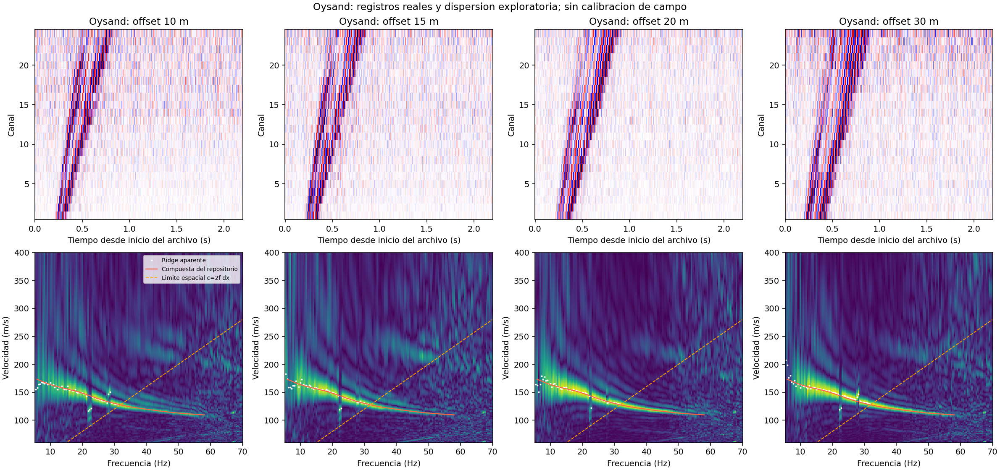
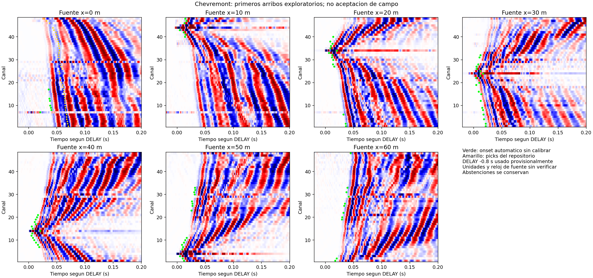

# Primeras pruebas con datos de campo públicos

## Ejercicio de dosier MASW — Oysand

[Abrir HTML](../../evidence/masw_quality/dossier.html) · [PDF](../../evidence/masw_quality/dossier.pdf) ·
[método y resultados](../../docs/masw_quality_dossier.md).
Los cuatro registros se reprocesan desde originales verificados: trazas, amplitudes,
coherencia en ambas direcciones, curvas aparentes, bandas y comparación de offsets.
Integridad de muestras PASS; evaluación integral NO_EVALUABLE por evidencia pendiente.
Incluye sensibilidad a ventana/canal trigger y archivos CSV/JSON/NPZ. No habilita Vs30.

## Dosier por canal y porcentaje de trazas buenas

El [nuevo dosier HTML](../../evidence/trace_quality/dossier.html) y su [PDF](../../evidence/trace_quality/dossier.pdf)
evalúan individualmente los 432 canales de campo, el ejemplo E2 y tres controles sintéticos.
Incluyen trazas verdes/buenas, amarillas/regulares y rojas/malas, motivos y porcentajes por registro y conjunto
con cortes de 90 % y 75 %. Ver [criterios y resultados](../../docs/trace_quality_dossier.md).
La evaluación de campo es no evaluable mientras los faltantes puedan cambiar la categoría. Chevremont
incluye 335 SNR condicionales finitas y una potencia neta no resuelta; 261 canales quedan en revisión,
73 solo con evidencia pendiente y los canales 7 y 29 del disparo 0 m rojos por anomalía local de forma.
Oysand mantiene 96 canales sin evaluación completa. Ver la [revisión contrastada](../../docs/revision_qc_trs_ruido.md).
No se identificaron canales cero o constantes.
El semáforo histórico de procesamiento descrito más abajo mide aspectos diferentes.

Estudio exploratorio iniciado el 7 de octubre de 2026. Se descargaron **11 registros multicanal** y sus archivos auxiliares, conservando originales, licencias y procedencia. Los 24 archivos descargados suman 9 511 444 bytes. El [manifiesto](download_manifest.json) fija los commits de origen y los hashes SHA-256 de todos los archivos.

| Conjunto | Datos originales | Procedencia |
|---|---|---|
| Oysand | Cuatro registros de 24 canales y 2201 muestras; 1 kHz, separación 2 m, offsets 10/15/20/30 m. Cabeceras: 6 de junio de 2018, fuente de martillo, último sample a 2.2 s. | [MASWavesPy](https://github.com/Mazvel/maswavespy/tree/8ae34e9a112aad4e68df34f58efde7d500621a89/examples/Data) |
| Chevremont | Siete SEG-2 de 48 canales y 4000 muestras; 2 kHz, `DELAY=-0.8 s`, `STACK=3`. Geometría de 48 receptores y siete fuentes; cabeceras: 10 de abril de 2024. | [SardineReborn](https://github.com/hadrienmichel/SardineReborn/tree/2d1fdac70d94aa0baa62e82ae5319feacfc4a19b/example/Chevremont) |

Los originales y las licencias acompañantes están en `raw/`. El script de descarga no ejecuta código del repositorio de origen. `Oysand_initial.csv` es un modelo inicial de inversión; no se usa como verdad del subsuelo.

Para repetir las pruebas con los archivos descargados, desde la raíz del proyecto:

```powershell
.\.venv\Scripts\python.exe tools/probe_field_data.py
```

El [script de descarga](../../tools/download_field_examples.py) se usa una sola vez para crear este snapshot. Si existe el manifiesto, se detiene para preservar los originales. El probe verifica todos los hashes antes de calcular.

## Reporte con semáforo por registro

Abrir el [reporte interactivo](../../evidence/field/quality_report.html), que incluye filtros por sitio y diagnóstico, detalle por registro, figuras y opción de imprimir/guardar PDF. También están disponibles la [versión Markdown](../../evidence/field/quality_report.md) y los [datos JSON](../../evidence/field/quality_report.json).

Un **mini conjunto es un registro multicanal**: cada canal es una traza. En Oysand son `r1–r4` del perfil P1, con offsets 10/15/20/30 m, según `Oysand_example_dataset.csv`. En Chevremont son los siete archivos por fuente de 0 a 60 m; cada uno conserva tres impactos apilados, sin acceso a los impactos individuales. Los registros se agrupan en **dos sitios**, no once sitios independientes.

El reporte separa **lectura/integridad**, **procesamiento**, **referencia** y **diagnóstico global**. Verde indica una dimensión comprobada; amarillo requiere revisión; rojo indica un problema según el criterio diagnóstico; gris significa evidencia insuficiente. Los cuatro registros MASW quedan amarillos por soporte parcial e identidad modal pendiente. Los siete TRS quedan rojos por baja cobertura del picker actual, aunque su lectura e integridad pasan. Este rojo no demuestra que la adquisición sea mala.

Los [criterios](quality_criteria.json) son locales y provisionales (`FIELD_DIAGNOSTIC_V1`), sin calibración de campo: cobertura TRS verde ≥80 %, amarillo ≥50 % y <80 %, rojo <50 %, incluyendo todas las abstenciones en el denominador. Las diferencias numéricas con las referencias se presentan sin adoptar un umbral de exactitud. La referencia compuesta MASW queda amarilla; TRS queda gris mientras falten etiquetas o verificación temporal. Un faltante obligatorio impide el diagnóstico verde y ningún resultado habilita aceptación de campo o Vs30.

Para regenerar el reporte desde los resultados existentes:

```powershell
.\.venv\Scripts\python.exe tools/report_field_quality.py
```

El generador verifica de nuevo hashes de originales y código del probe, y se detiene si detecta un snapshot modificado. Registra hashes de los insumos, criterios y generador en el JSON del reporte. Si se cambia el procesamiento, se debe ejecutar primero el probe. La generación del reporte conserva las muestras y los resultados originales.

## Resultados iniciales

Los [resultados completos](../../evidence/field/results.json) registran dependencias, hashes del código, protocolos, checks y limitaciones. **65/65 comprobaciones técnicas** pasan: integridad, formas, coherencia finita, mapeo de anotaciones por coordenadas y lectura SEG-2 contra ObsPy. Esto no es un gate de aceptación de campo. Las [77 pruebas de regresión](../../evidence/field/regression.json) seleccionadas de ingesta, picking y MASW también pasan.

**MASW:** se ejecutan `phase_shift`, `ridge_path` y el stack Fourier espacial de amplitudes sobre los cuatro registros, con media eliminada y ventana Hann sobre el registro completo. Las frecuencias son bins FFT observados entre 5 y 70 Hz, con rejilla de velocidades de 60 a 400 m/s. La curva aparente se compara con la curva compuesta del mismo sitio que contiene el repositorio.

| Offset | Bins comparados sin alias espacial en la curva candidata | Mediana de diferencia absoluta | RMS de diferencia |
|---|---:|---:|---:|
| 10 m | 57 | 0.78 m/s | 7.17 m/s |
| 15 m | 58 | 1.19 m/s | 5.76 m/s |
| 20 m | 58 | 1.20 m/s | 4.95 m/s |
| 30 m | 58 | 2.09 m/s | 6.39 m/s |

La comparación se restringe al soporte de frecuencia de la curva compuesta y a candidatos con `c > 2*f*dx`. La compuesta es una referencia de procesamiento del mismo sitio, no verdad independiente ni etiquetas por disparo. La identidad modal permanece `APPARENT`; una cresta de coherencia por sí sola no la confirma. El alias espacial afecta parte de la banda alta: no se declara toda la banda de 5–70 Hz utilizable. El header menciona el receptor 1 como trigger; el procesamiento mantiene provisionalmente los 24 canales que usa el ejemplo original. Excluir solo ese canal conserva la mediana de la curva, pero puede desplazar puntos aislados entre 34 y 52 m/s en el rango completo; el papel del canal debe verificarse.



**TRS:** el decodificador local reproduce exactamente las muestras y `dt` de los siete registros leídos por ObsPy. Los headers conservan `DELAY=-0.8 s`; ObsPy advierte que no valida ese delay y no lo incorpora a su starttime. Se usa provisionalmente la referencia temporal del header para el picking, sin corrección de reloj inferida desde las anotaciones.

Se ejecuta el picker existente con protocolo exploratorio fijo: ruido `[-0.25,-0.05) s`, búsqueda `[0,0.18) s`, STA/LTA+AIC y preprocesamiento `RAW_DC_REMOVED`, sin filtros adicionales ni calibración sintética transferida. Produce **92 onsets sin calibrar, 243 abstenciones por ambigüedad y 1 ausencia** en 336 trazas. La mayoría de las abstenciones corresponde a múltiples episodios de energía. Ningún canal es constante ni completamente cero; esto no certifica ausencia de saturación.

El `test.sgt` aporta **43 anotaciones, todas de la fuente x=0 m**. Se mapean por coordenadas, no por la posición de sus filas: contiene solo parte de los receptores. Seis tienen onset automático; en ese subconjunto, la diferencia absoluta media es **26.34 ms**, con mediana firmada de **−26.44 ms**. El resultado debe leerse junto con las 37 abstenciones del subconjunto anotado. La causa puede involucrar el criterio de onset, la referencia temporal o las anotaciones; no se atribuye de momento a un sesgo instrumental o error verdadero del picker, y no se aplica una corrección para forzar coincidencia.



## Alcance y próximos pasos

Estas pruebas operan sobre arrays originales. Oysand es texto multicanal, todavía fuera de la ingesta SEG-Y/SEG-2. Chevremont se decodifica, pero la ingesta completa rechaza correctamente la ausencia de sidecar (`METADATA_MISSING`). El adapter exploratorio del picker lleva solo muestras, máscaras, `dt` y `DELAY`, con onda P provisional: **no construye un `Shot` validado ni certifica componente, unidades, incertidumbre geométrica o reloj de fuente**.

Chevremont declara `UNITS NONE`; su header repite la misma posición GPS en todos los canales y deja la fuente en cero. El archivo `.geometry` aporta una línea local con topografía y un orden provisional de receptores compatible con `CHANNEL_NUMBER`. La incertidumbre de levantamiento y el convenio vertical no están documentados. `STACK=3` describe un agregado y no permite analizar saturación de cada golpe. No hay calibración de respuesta/rails ADC ni confirmación externa de P/Z.

El siguiente experimento debe resolver primero la discrepancia temporal de Chevremont mediante inspección de trazas y adjudicación de anotaciones. Después se puede definir un protocolo de picking para campo y evaluar abstención y diferencia en disparos separados. Para Oysand falta comprobar el canal trigger, estudiar sensibilidad a ventana y alias espacial y documentar la adquisición antes de una adaptación formal de ingesta. La inversión horizontal TRS, la aceptación de Vs30 y G9 siguen pendientes.

Los CSV de curvas, picks y comparación de anotaciones, espectros NPZ y cabeceras JSON se guardan en `evidence/field/`. Los datos de un mismo sitio no se tratan como sitios independientes para calibración estadística.
